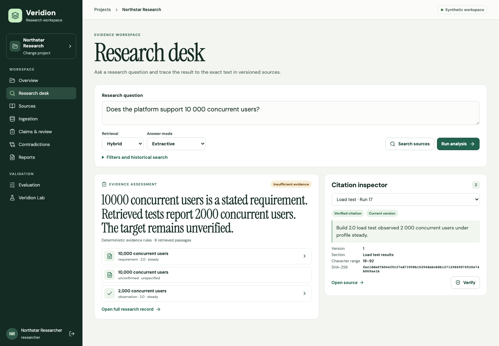

# Veridion · Evidence-based research workspace

[Русский](README.ru.md) · [Home](README.md)

Veridion links research questions to traceable evidence and review decisions. The synthetic **Northstar Research** corpus illustrates a common failure in technical analysis. A specification sets a goal of 10,000 concurrent users, while a benchmark reports an observation at 2,000 users. The evidence supports the measured result within the test conditions and leaves the target unverified.

## Start locally

```bash
git clone https://github.com/bivaettttt/veridion.git
cd veridion
docker compose up -d --build --wait
```

Open the [workspace](http://localhost:3817) and [API documentation](http://localhost:3817/api/docs). The first build downloads the pinned embedding artifact. Wait for the import monitor to show the seeded jobs as done. The first vector query initializes the local model.

Use **Fill local demo credentials** to enter the workspace as researcher. The seeded accounts use `researcher`, `analyst`, `reviewer`, `admin` or `guest` at `northstar.test`, with the demo passphrase `northstar-workspace`. The guest account has no Northstar membership. These accounts and lab routes are enabled by `VERIDION_DEMO=1` in the loopback Compose environment. Set `VERIDION_DEMO=0` on a fresh database to bootstrap a user with `docker compose exec api python -m veridion.bootstrap`. Sample ports are listed in [configuration](.env.example).

## Research workflow

1. Upload a UTF-8 TXT, Markdown, HTML, text PDF or DOCX document. The worker retains original bytes, their SHA-256 digest, the normalized text, paragraph or page boundaries and character offsets.
2. Search by keyword, semantics or hybrid rank. Filters include category and an as-of instant. Historical source links preserve the selected version.
3. Run analysis. The extractive engine identifies capacity, availability and explicit interface assertions, preserves selected modality and test conditions, and flags evidence gaps or disagreements.
4. Open the citation inspector. It verifies the exact excerpt, source version, project membership and the original answer context. The verifier shows citation integrity and freshness. Support is assessed separately.
5. Send the answer to a reviewer. Review transitions carry a revision and rationale. Export a report snapshot as JSON or Markdown and compare it with a later snapshot.



## Architecture and model configuration

The repository contains the [backend](backend/), [frontend](frontend/), [documentation](docs/), [scripts](scripts/) and [Playwright screenshots](assets/screenshots/). Docker Compose runs React/Nginx, FastAPI, a separate import worker and PostgreSQL 16 with pgvector. Alembic migrations establish the immutable entities and FTS index. Source versions own sections and chunks, which own versioned embeddings. A saved search records the passages it ranked. Answers link to verified citations, review history and report snapshots.

PostgreSQL full-text ranking uses simple, English and Russian dictionaries. Multilingual E5-small creates 384-dimensional vectors locally. Cosine distance ranks semantic matches. Hybrid search merges separate ranks with reciprocal rank fusion at k=60. The saved configuration includes the embedding artifact and the chunking revision.

### Optional local LLM

A host Ollama instance needs access to the local `qwen2.5:3b` model and about 2 GB for its model files plus inference memory. On Docker Desktop, point Compose to the host instance:

```bash
ollama pull qwen2.5:3b
VERIDION_OLLAMA_URL=http://host.docker.internal:11434 docker compose up -d --wait
python3 scripts/check_model.py
```

The adapter sends a bounded set of evidence excerpts, stores the model digest and prompt revision, and verifies every short reference against the supplied context. Generation is a reviewable draft. The default extractive mode uses local rules and PostgreSQL without the language model.

## Evaluation, lab and security

The labelled Northstar set reports source recall, reciprocal rank, citation integrity, evidence assessment accuracy and abstention on the missing-evidence cases. Compare saved runs by retrieval mode. The lab checks 24 scenarios in a disposable transaction and persists the results. [Lab screenshot](assets/screenshots/lab.png) · [Evaluation screenshot](assets/screenshots/evaluation.png)

The browser shares its origin with the API. Sessions use HttpOnly cookies, passwords use salted scrypt, and backend queries check project membership. Sources are treated as data. Model calls have no tools, and generated references are restricted to known excerpts. [Threat model](docs/architecture/design.md#threat-model)

[GitHub Actions](https://github.com/bivaettttt/veridion/actions/workflows/quality.yml) runs lint, type checks, unit and PostgreSQL API tests, OpenAPI and documentation checks, the frontend build, Playwright and secret scanning. The separate model script uses an actual Ollama model. [Test plan and observed results](docs/testing/verification.md)

## Scope and status

This portfolio MVP uses synthetic documents and a narrow typed evidence vocabulary. Text PDFs require a text layer. Retrieval and evidence metrics describe the small seed dataset. Further work includes larger labelled sets, richer claim semantics, batch-scale indexing, and a production access and deployment design. See the [known limitations](docs/PROJECT_STATUS.md). No open-source license is currently declared.

[Requirements](docs/analysis/requirements.md) · [Architecture](docs/architecture/design.md) · [Data model](docs/diagrams/model.mmd) · [API contract](docs/api/README.md) · [Portfolio case](docs/PORTFOLIO.md)
