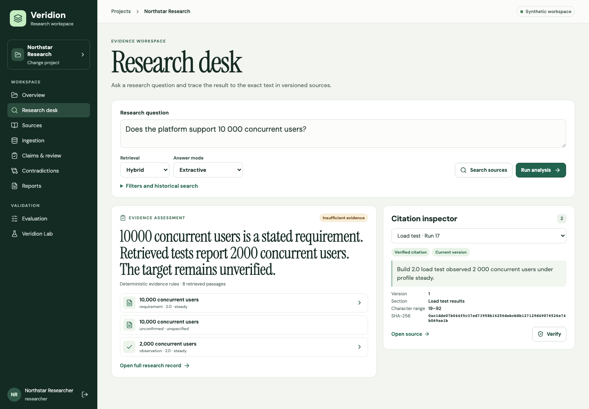

# Veridion

**[Русский](README.ru.md) · [English](README.en.md)**

Исследовательская платформа с версиями документов, гибридным поиском, проверяемыми цитатами и журналом согласования.

An evidence-based research workspace with versioned documents, hybrid retrieval, verifiable citations and human review.

[](https://github.com/bivaettttt/veridion/actions/workflows/quality.yml)



```bash
docker compose up -d --build --wait
```

Open [the workspace](http://localhost:3817). Use **Fill local demo credentials**, sign in and open **Northstar Research → Research desk**. Run the prefilled question to compare the 10,000-user target with the test at 2,000 users.

React → FastAPI → PostgreSQL + pgvector. A separate worker parses and indexes documents. The optional Ollama adapter produces a draft for review using the retrieved project context.

[Requirements](docs/analysis/requirements.md) · [Architecture and ADRs](docs/architecture/design.md) · [API](docs/api/README.md) · [Verification](docs/testing/verification.md) · [Project status](docs/PROJECT_STATUS.md)
