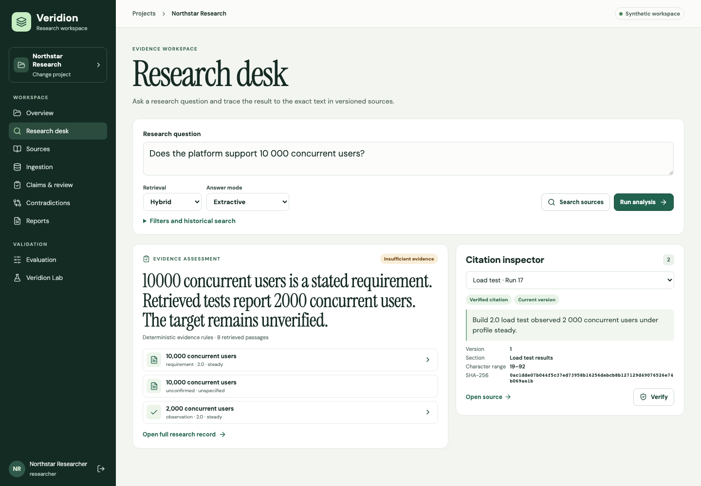

# Veridion · Рабочее пространство доказательных исследований

[English](README.en.md) · [Главная](README.md)

Veridion связывает исследовательские вопросы с проверяемыми свидетельствами и решениями проверяющих. Синтетический корпус **Northstar Research** показывает типовую проблему технического анализа. Спецификация задаёт цель в 10 000 одновременных пользователей, а нагрузочный тест сообщает результат для 2 000. Свидетельство поддерживает измеренное значение в границах испытания. Целевой показатель остаётся непроверенным.

## Локальный запуск

```bash
git clone https://github.com/bivaettttt/veridion.git
cd veridion
docker compose up -d --build --wait
```

Откройте [рабочее пространство](http://localhost:3817) и [документацию API](http://localhost:3817/api/docs). При первой сборке скачивается зафиксированная версия embedding-модели. Дождитесь завершения импорта в Ingestion. Первый векторный запрос загружает модель в память.

Кнопка **Fill local demo credentials** подставляет данные исследователя. Учебные аккаунты используют `researcher`, `analyst`, `reviewer`, `admin` или `guest` в домене `northstar.test` и фразу `northstar-workspace`. Гость не состоит в проекте Northstar. Локальный Compose включает аккаунты и лабораторию через `VERIDION_DEMO=1`. Чтобы создать собственную учётную запись на чистой базе, задайте `VERIDION_DEMO=0` и выполните `docker compose exec api python -m veridion.bootstrap`. Порты перечислены в [конфигурации](.env.example).

## Исследовательский процесс

1. Загрузите UTF-8 TXT, Markdown, HTML, текстовый PDF или DOCX. Worker сохранит исходные байты, SHA-256, нормализованный текст, разделы или страницы и символьные диапазоны.
2. Найдите фрагменты по ключевым словам, смыслу или гибридному рангу. Доступны фильтры по категории и времени актуальности.
3. Запустите анализ. Извлекающий модуль выделяет утверждения о нагрузке, доступности и интерфейсах, учитывает модальность и известные условия, показывает пробелы в доказательствах и расхождения.
4. Откройте цитату. Сервис сверит точный текст, версию, доступ к проекту и контекст запуска. Целостность и актуальность ссылки отображаются отдельно от поддержки утверждения.
5. Передайте вывод на проверку. Каждый переход сохраняет номер ревизии и обоснование. Снимки отчёта можно сравнить и выгрузить в JSON или Markdown.



## Архитектура и модели

[Backend](backend/), [frontend](frontend/), [документация](docs/), [скрипты](scripts/) и [скриншоты Playwright](assets/screenshots/) находятся в одном репозитории. Docker Compose запускает React/Nginx, FastAPI, отдельный worker и PostgreSQL 16 с pgvector. Alembic создаёт таблицы, ограничения неизменяемости и полнотекстовый индекс. Версии содержат разделы, фрагменты и векторы. Запуск поиска хранит ранжированные фрагменты. С ответом связаны цитаты, история согласования и снимки отчётов.

Полнотекстовый поиск использует словари simple, English и Russian. Многоязычная модель E5-small локально вычисляет 384-мерные векторы. Семантический поиск использует косинусную дистанцию. Гибридный режим объединяет два ранга по reciprocal rank fusion с k=60. Метаданные запуска содержат версии модели и фрагментации.

### Локальная LLM

Для Ollama нужна модель `qwen2.5:3b`. Веса занимают около 2 ГБ, при генерации потребуется дополнительная память. На Docker Desktop Compose может использовать модель на хосте.

```bash
ollama pull qwen2.5:3b
VERIDION_OLLAMA_URL=http://host.docker.internal:11434 docker compose up -d --wait
python3 scripts/check_model.py
```

Адаптер передаёт ограниченный набор фрагментов, сохраняет хеш модели и версию промпта и проверяет ссылки по переданному контексту. Сгенерированный черновик требует проверки. Режим по умолчанию использует PostgreSQL и детерминированные правила извлечения.

## Оценка, лаборатория и безопасность

Размеченный набор Northstar измеряет полноту поиска по источникам, средний обратный ранг, целостность цитат, совпадение оценки с разметкой и воздержание при недостатке сведений. Запуски разных режимов доступны в истории. Лаборатория выполняет 24 сценария в изолированной транзакции и сохраняет результаты. [Лаборатория](assets/screenshots/lab.png) · [Метрики](assets/screenshots/evaluation.png)

Интерфейс и API работают на одном origin. Сессии используют HttpOnly cookie, пароли хешируются с солью через scrypt, доступ проверяется по членству в проекте. Документы передаются как данные. Модель работает без инструментов, ссылки ограничены переданными фрагментами. [Модель угроз](docs/architecture/design.md#threat-model)

[GitHub Actions](https://github.com/bivaettttt/veridion/actions/workflows/quality.yml) проверяет линт, типы, unit и PostgreSQL API-тесты, OpenAPI, документацию, сборку, Playwright и секреты. Генеративный сценарий проверяется отдельным скриптом с реальной моделью Ollama. [Тест-план и фактические результаты](docs/testing/verification.md)

## Границы и статус

Учебный MVP опирается на синтетический корпус и ограниченный словарь свойств. PDF должен содержать текстовый слой. Метрики относятся к небольшому размеченному набору. Возможные улучшения включают расширение корпуса, правил извлечения и инфраструктуры для масштабного импорта. Подробности в [статусе проекта](docs/PROJECT_STATUS.md). Лицензия открытого исходного кода пока не заявлена.

[Требования](docs/analysis/requirements.md) · [Архитектура](docs/architecture/design.md) · [Модель данных](docs/diagrams/model.mmd) · [Контракт API](docs/api/README.md) · [Кейс для портфолио](docs/PORTFOLIO.md)
